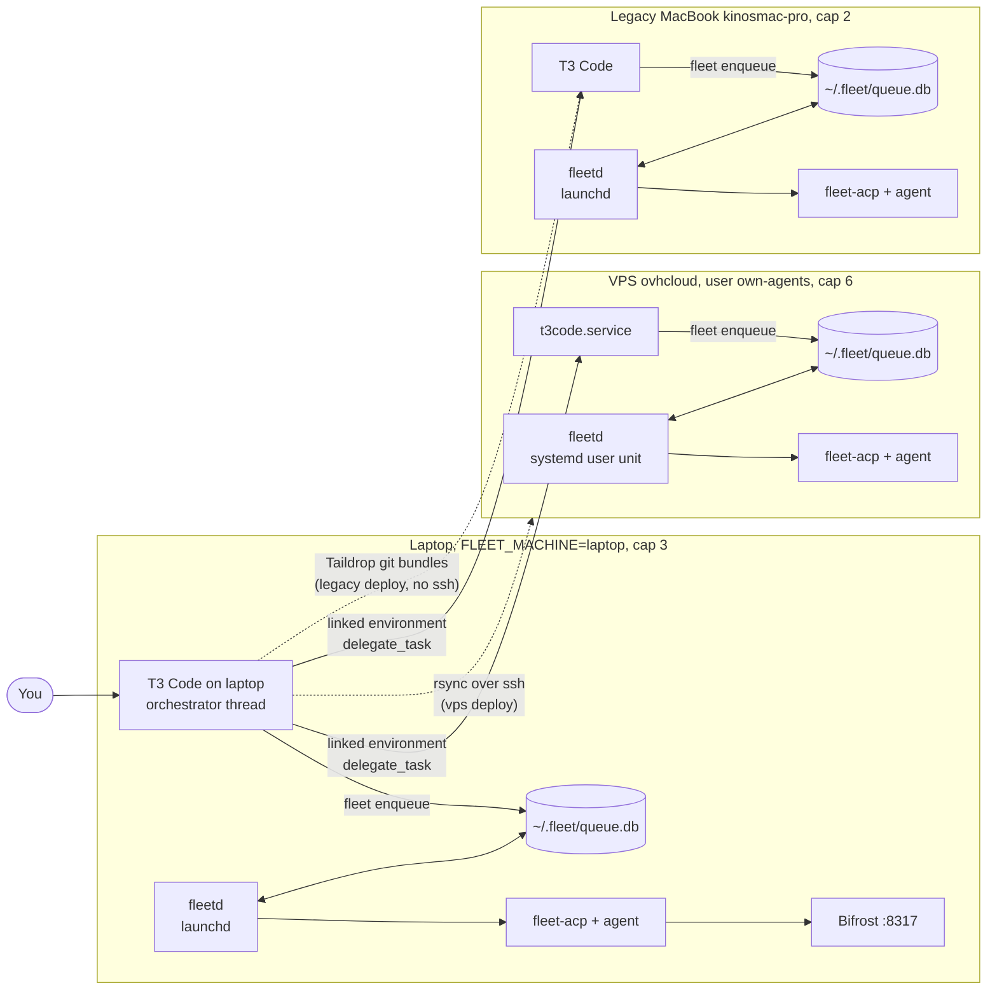
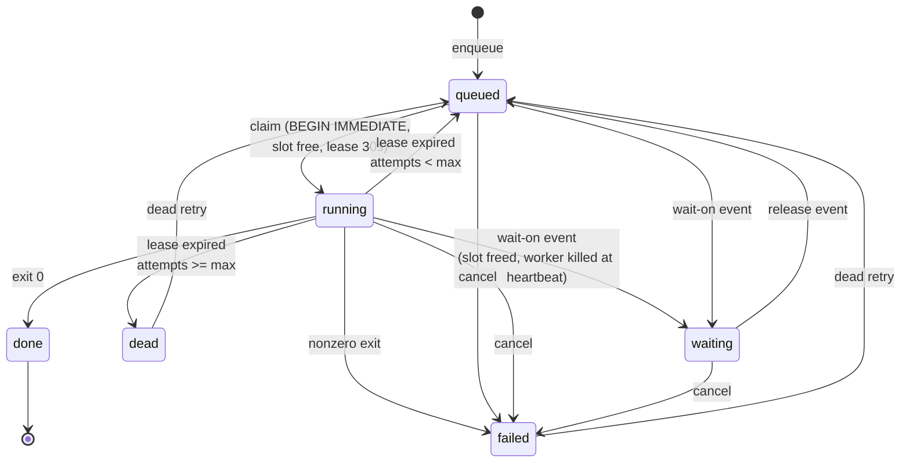
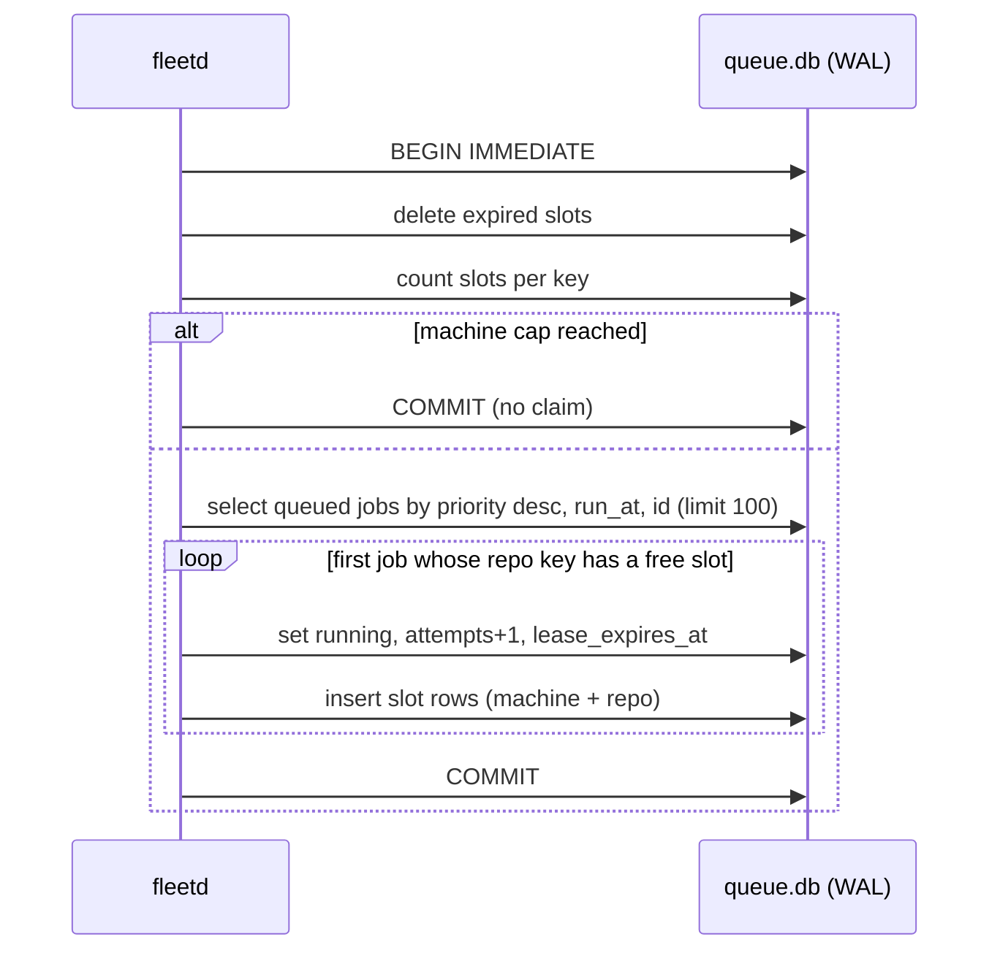
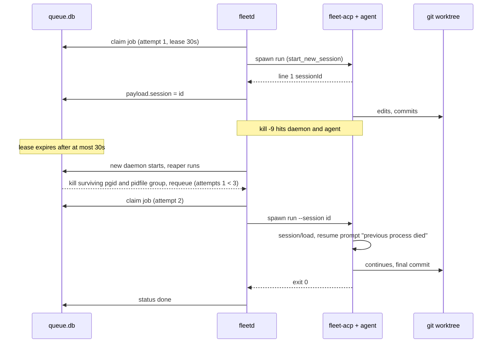
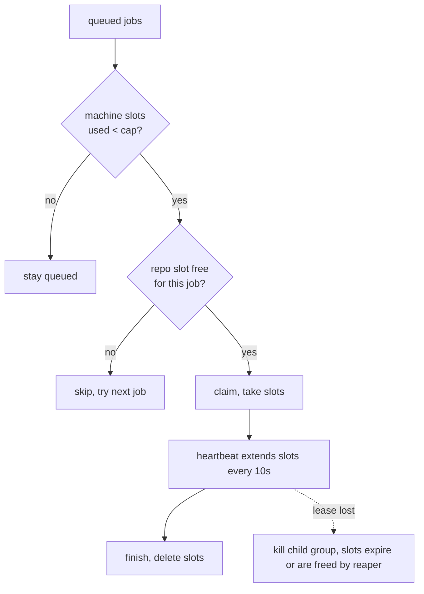
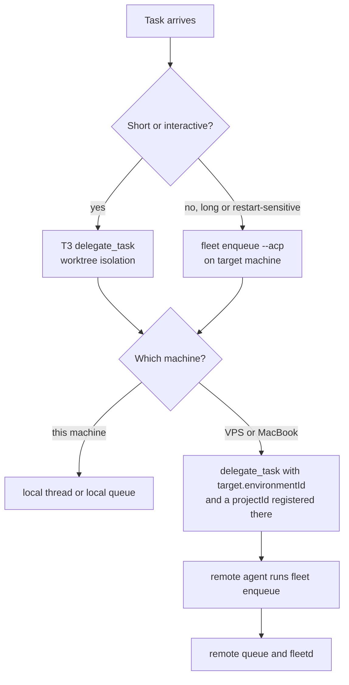

# Architecture

How agent work is dispatched, queued, capped and made durable across the laptop, the VPS and the legacy MacBook.

Status as of 2026-11-20. Verified behaviour is marked in [Verification status](#verification-status). Anything not listed there is intended design, not tested fact.

## One-paragraph summary

T3 Code is the control surface and the transport between machines (linked environments).
`fleet` is a per-machine SQLite job queue with lease-based concurrency caps and a small dispatcher daemon.
`fleet-acp` is a CLI that runs one coding agent over the Agent Client Protocol and can resume its session after the process dies.
`nira-fleet` packages and deploys all of it as a launchd or systemd service per machine.
Durability comes from three layers: the queue (jobs survive daemon death), the agent transcript (sessions survive process death via `session/load`) and git (work survives both).

## Topology

Queues are per machine. The SQLite file is never shared. Cross-machine coordination happens only through T3 dispatch and git.

## Services

| Service | Where it runs | Role | State it owns |
|---|---|---|---|
| T3 Code | every machine | UI, thread orchestration, `delegate_task`, linked environments, project registry | threads, linked-environment tokens, per-machine project list |
| `fleetd` (`fleet daemon`) | every machine, launchd or systemd user unit | claim loop, subprocess execution, lease heartbeat, reaper | nothing in memory that matters, all state is in SQLite |
| `fleet` CLI | every machine | `enqueue`, `status`, `wait-on`, `release`, `cancel`, `stats`, `dead retry` | writes the queue |
| queue DB | `~/.fleet/queue.db` per machine | the durable job table and the concurrency slot table | jobs, slots |
| `fleet-acp` | spawned per job by `fleetd` | one ACP agent run, session create or `session/load`, model selection, prints the sessionId | agent transcript on disk (agent-owned) |
| ACP agent | child of `fleet-acp`, own process group | the actual coding agent (`claude-code-acp`, opencode) | transcript, tool state |
| Bifrost | laptop and VPS | LLM gateway, routing and aliases | provider keys, routing |
| `nira-fleet` | laptop control host | inventory, manifest, deploy scripts, service templates | deployment definitions |
| git and worktrees | every machine | the work product and the carrier of task docs | commits on branches |

### fleetd

Single-threaded loop, with one helper thread per ACP job that reads the first stdout line.
Each tick it does the following, in order.

1. Poll running children, mark `done` (exit 0) or `failed` (nonzero).
2. Every `lease/3` seconds (10s default), heartbeat each running job. If a heartbeat returns false (cancelled, parked, reaped), kill that child process group.
3. Every `lease/3` seconds, run the reaper.
4. While `running < machine_cap`, claim another job.
5. Sleep with backoff, 50ms when busy and up to 2s when idle.

On shutdown it kills its children. After a crash the leases simply expire and the reaper requeues.

### Queue and slots

Two tables carry the whole design.
`jobs` holds kind, payload, status, priority, run_at, lease owner and expiry, attempts, `pgid` and `pidfile` (for orphan reaping).
`concurrency_slots` holds one row per job per partition key.

Partition keys per job are `machine:<name>` and, when the payload has `repo` or `cwd`, `repo:<abspath>`.
Caps are `FLEET_CAP` (machine, default laptop 3 and vps 6, anything else 3, the legacy MacBook sets 2 through the env var) and `FLEET_REPO_CAP` (default 1).

### Claim protocol

A blocked job stays `queued`, so a repo at its cap does not stall jobs for other repos.
Cap enforcement is race-free because the count and the insert happen inside one write transaction.

### fleet-acp

`fleet-acp run <agent> --cwd <dir> --prompt <text> [--session <id>] [--model <id>] [--pid-file <f>]`.

- Line 1 of stdout is `{"sessionId":"..."}`, printed as soon as the session exists. `fleetd` persists it into the job payload immediately.
- Exit 0 only on `end_turn`.
- With `--session` it calls `session/load` and prepends a resume prompt saying the previous process died and background shells are gone.
- The agent is started detached in its own process group, and its pid goes to the pid file.
- Claude runs headless with an isolated `CLAUDE_CONFIG_DIR` and `bypassPermissions`. Credentials come from an env token, the macOS Keychain, or `~/.claude/.credentials.json` on Linux (copied once).
- Model selection is `session/set_model` after session create and after load. Full ids map to the adapter's families (`default`, `sonnet`, `haiku`).
- On exit it sends SIGTERM to the agent group, waits up to 3s so the transcript flushes, then SIGKILL.

## Durable execution

What survives what:

| Failure | What recovers it | Mechanism |
|---|---|---|
| `fleetd` killed | service manager restarts it, reaper requeues | launchd `KeepAlive`, systemd `Restart=on-failure`, 30s lease |
| Agent process killed | same retry path | `session/load` replays the transcript |
| Machine reboot | service starts at boot, queue file persists | systemd lingering, launchd `RunAtLoad`, WAL SQLite |
| Network loss | nothing needed for enqueue | enqueue is a local file write |
| Lost in-flight tool output | not recovered | the retry is at-least-once, so job commands must be idempotent |

Delivery is at-least-once. A killed attempt can have written partial files. Commit often so the retry sees them.

## Concurrency caps

- Machine cap: laptop 3, VPS 6, legacy MacBook 2.
- Repo cap: 1 job per repo path at a time, across all kinds.
- A `waiting` job holds no slot, so parked work does not count against the cap.

## Delegation

Rules:

- Another machine needs a project registered there (`t3 project add`). Projects do not sync.
- Delegated work follows the existing discipline: scoped goal, monitor, time box, never wait. Completion arrives as a notification, not by polling.
- Monitoring a queued job is one read of `fleet status` or `fleet stats`.
- Implementation work belongs on the VPS (the legacy MacBook is a spare), exploration stays on the laptop. See `~/rules/delegation.md`.

## Deployment

- `nira-fleet/scripts/fleet-deploy.sh laptop` installs in place and loads the launchd agent.
- `fleet-deploy.sh vps` rsyncs both repos, runs `uv sync` and `pnpm install --frozen-lockfile`, renders the systemd user unit and always restarts only `fleetd.service`.
- `fleet-deploy.sh legacy` makes git bundles, sends them with `tailscale file cp`, and prints the task text for a T3 `delegate_task` aimed at the MacBook (no ssh needed).
- launchd cannot read `~/Documents`. Checkouts on the MacBook live in `~/.local/share/fleet`, and plists use `WorkingDirectory=$HOME`.
- Service quirks: start through `zsh -lc 'exec fleet daemon'` so the login environment reaches the daemon, `KillMode=process` and `AbandonProcessGroup` so a daemon restart does not kill running children, quote `Environment=` values that contain spaces.

## Known gaps

- Cancel or park kills the child group only. An ACP agent runs detached in its own group, so its process can outlive a cancelled job until something reaps its pid file. The reaper handles expired leases, not cancels. Not yet tested.
- A crash between claim and the `pgid` write leaves one child untracked.
- The legacy cap is set by env var, not by a default in the code (`MACHINE_CAPS` knows only laptop and vps).
- Cancelled jobs are recorded as `failed`.
- No load test exists yet, so the caps are configured, not measured.
- Claude resume after a kill in the middle of a half-finished tool call is untested.
- `fleet enqueue` has no label field, so test jobs are identified by prompt text.

## Verification status

Verified (automated tests or recorded runs):

- Cap holds at 3 with 10 jobs, at 6 with 14 jobs, and per-repo cap 1 under parallel load.
- `kill -9` of daemon and agent mid-task, then completion on attempt 2 with the same session, for opencode on laptop, VPS and legacy MacBook, and for Claude on laptop and VPS (Claude also on the MacBook through its pilot test).
- Real service restart after `kill -9`: launchd on laptop and MacBook, systemd on the VPS.
- VPS reboot: `fleetd` and `t3code` came back on their own.
- T3 dispatch from the laptop into the VPS queue.
- Taildrop plus T3 task install on the MacBook with no ssh.

Not verified: see Known gaps.
