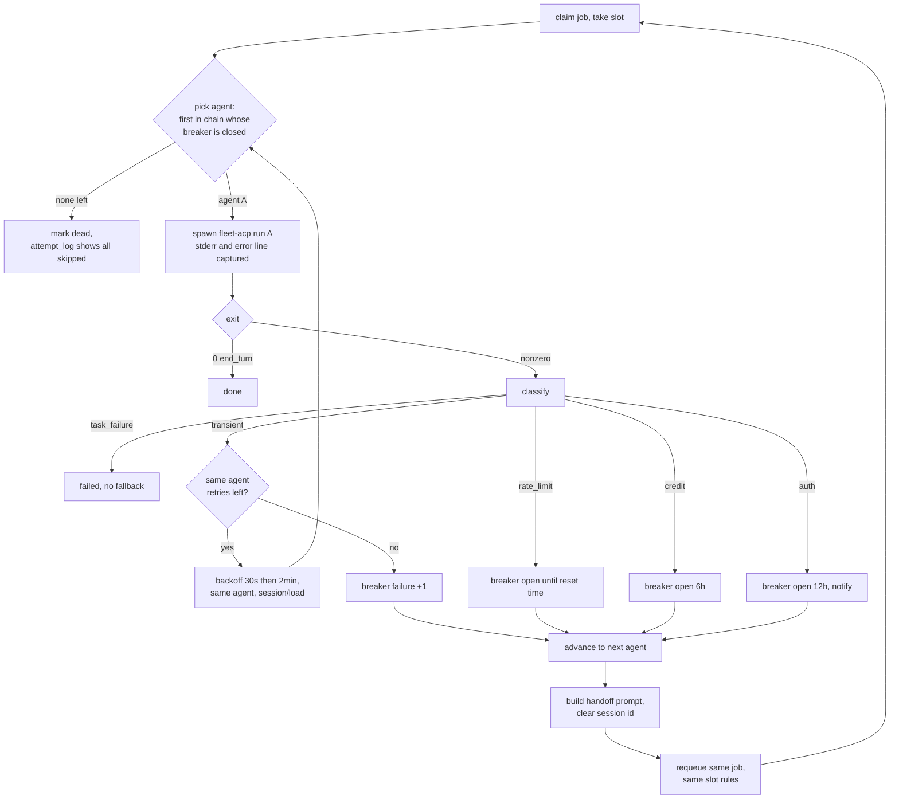

# Cross-harness fallback design

Status: research and design, 2026-11-20. Nothing here is implemented. Evidence is marked as read (source or log), probed (ran a read-only command) or unverified (inferred).

## Question

When a harness or model runs out of credits, is rate limited or is unauthenticated, how do we fall back automatically to the next harness (proposed order: claude, devin, agy, maki, opencode) for (A) interactive and delegated T3 Code threads and (B) background `fleet` jobs.

## Short answer

(A) T3 has a partial, client side fallback that only picks a different model when you start a new thread.
It does not switch a running thread and `delegate_task` has no fallback option.
(B) Fleet has no fallback at all today. A nonzero exit is a terminal `failed`, and the retry counter only applies to expired leases.
Bifrost fallbacks are real and ordered, but Bifrost has no Anthropic provider configured here, so they cannot rescue Claude, Devin or agy. They only cover harnesses that talk to Bifrost aliases (maki, codex, crush, opencode with the `bifrost` provider).
So cross-harness fallback has to live in fleet (a new failure classifier plus requeue with the next agent), and for T3 threads it has to be a thin wrapper or an orchestrator rule built on `t3 thread start --wait`.

## 1. What T3 Code has

T3 Code v0.1.10, runtime at `~/.t3/runtime/versions/0.1.10`.

### Exists

| Feature | Evidence | What it does | Limits |
|---|---|---|---|
| `fallbackModelSelection` setting | `~/.t3/userdata/settings.json` (currently maki, `bifrost/codex-execute`). Schema in the client bundle (`utils-*.js`). Logic in `usageLimits-*.js`, function `d` | When a new thread or draft has no explicit model and the default provider has an exhausted usage window, the composer switches to the fallback selection | Client side. New threads only. Needs the default provider to report `usageLimits`. The fallback must be enabled, installed, not `unauthenticated`, not itself exhausted, and allowed for the project |
| `autoResumeLimitedThreads` and `snoozeLimitedThreads` | Settings schema. Server `UsageLimitRecoveryWorker` in the `t3` binary (read via strings). `autoResumeLimitedThreads` is `true` in this machine's settings | A failed thread with `lastErrorClass == usage_limit` and a `usageLimitResetAt` gets the message "Continue where you left off." after the reset time | Same provider, same model, so it is a wait, not a fallback. Ignored when the reset is more than 24h old. Ignored for threads that are archived, settled or have a pending request |
| Failure taxonomy | `OrchestrationV2ProviderFailureClass` in the binary: `usage_limit`, `provider_error`, `transport_error`, `permission_error`, `validation_error`, `unknown`. Failure struct carries `class`, `message`, `code`, `retryable`, `resetAt` | Per run failure metadata shown in the UI | Only classes the adapter chooses to set |
| Per driver detection | Binary: Claude adapter maps `api_error_status 429` and a gateway 503 wrapping a 429 to `usage_limit` with `resetAt`. Antigravity adapter maps `QUOTA_EXHAUSTED`, `RESOURCE_EXHAUSTED` and 429. Codex adapter has managed usage limit codes | Sets `usage_limit` plus reset time | Native drivers only |
| CLI | `t3 thread start --provider <id> --model <slug> --wait`, `--json`. `--wait` exits 1 if the run fails and 2 if it waits for an answer | A scriptable way to run a thread on a chosen provider and read the result | No fallback flag. `t3 --help`, `t3 thread start --help` and `t3 policy` show none |

### Does not exist

- No retry on another provider for a thread that is already running or has failed. The only recovery is the same provider after the reset.
- No fallback chain, only a single `fallbackModelSelection`.
- No fallback option on `delegate_task`. `orchestrator_capabilities` returned per provider `canRunChildTask` and models and no fallback field. A delegate task runs on the provider and model you name (or inherits the parent's). If the provider fails, the child thread ends `failed` and the parent sees it through `task_status`. T3 will not retry elsewhere. (Read from the tool schema and capabilities, not tested by forcing a failure.)
- No usage-limit detection for ACP registry providers. In `AcpAdapterV2` a prompt failure is finalized as `provider_error` unless the flavor supplies `promptFailure`. Observed in `~/.t3/userdata/logs/boot-service.log`: Devin returned `AcpRequestError: Reached free model rate limit. Upgrade to Max for higher limits, or switch to a different model. Your limit will reset in 3 seconds (at 19:14 UTC).` on `session/prompt`, logged as `orchestration-v2.acp-prompt-failed` for both a delegated task and a normal thread. Whether the UI then labels it `usage_limit` is unverified, so `autoResumeLimitedThreads` probably does nothing for devin, agy, maki and kimi (all `acpRegistry` here).
- Also in the same log: `AcpRequestError: Internal error` (3 times, no detail), which is exactly the unclassifiable shape.

### What this means for (A)

- Keep `fallbackModelSelection` as the cheap first layer. Today it points at maki `bifrost/codex-execute`, which only triggers when the default provider reports `usageLimits`. The default is also maki, so it never triggers. If the default becomes claude, it will trigger for Claude only.
- For delegated tasks, add the fallback in the orchestrator discipline, not in T3: when a child ends `failed` with a limit or auth error, relaunch it with the next provider from the chain, with a handoff prompt (section 4.4). This is a rule in `~/rules/delegation.md` plus one helper script, not a T3 feature.
- Helper script idea: `t3-run-chain <project> <prompt-file> claude:claude-sonnet-5-5 devin:swe-2-flash-medium agy:gemini-3.8-flash maki:bifrost/codex-execute` that loops `t3 thread start --provider ... --model ... --wait --json` and moves on when exit is 1 and the classifier says limit, auth or transient. Interactive threads stay manual.

## 2. Bifrost fallbacks

Read-only calls against `localhost:8317` using the documented Keychain method (`bifrost-api`), no secrets printed, no config changed. Docs read at docs.getbifrost.ai (features/fallbacks, governance/routing, providers/routing-rules).

### Running instance

- Providers configured: `kimi-for-coding`, `minimax-coding-plan`, `openrouter`, `zai-coding-plan`. There is no Anthropic, OpenAI or Google provider. (Probed `GET /api/providers`.)
- Routing rules (probed `GET /api/governance/routing-rules`):

| Alias | Rule | Weighted targets | Rule `fallbacks` |
|---|---|---|---|
| `codex-plan` | `rule-plan-001`, priority 10 | zai `glm-5.3-flash` 0.4, kimi `k3-256k` 0.3, minimax `MiniMax-M3.1-Flash` 0.3 | the same three providers in order kimi, minimax, zai |
| `codex-execute` | `rule-execute-001`, priority 20 | minimax `MiniMax-M2.7-highspeed` 0.4, kimi `kimi-for-coding` 0.3, zai `glm-5-turbo` 0.3 | the same three, kimi, minimax, zai |
| `codex-free` | `router-openrouter-free` | four openrouter `:free` models 0.25 each | `openrouter/free` |

### Semantics (from the docs)

- Request level: `"fallbacks": ["provider/model", ...]` next to `model`. Rule level: `fallbacks` on the rule (strings or objects with `key_id`), applied after the weighted target is chosen.
- Fallback runs on "whatever the error" after the primary's retries are used up: 429 (after key rotation), 5xx, network, timeouts. 401, 402 and 403 mark the key dead and rotate keys. If all keys die Bifrost returns `502 upstream_credentials_exhausted` (the docs do not say this triggers a fallback explicitly, so unverified).
- Not triggered by: caller cancellation, a plugin setting `AllowFallbacks = false`, deadline expiry, and caller-fault 4xx when the fallbacks came from the model catalog.
- Each provider has its own `max_retries` (default 0) and backoff 500 ms to 5 s. Retries multiply across the chain.
- If every attempt fails, the primary's error is returned, not the last fallback's. Success reports `extra_fields.routing_info` with `is_fallback`, `primary_provider`.
- Streaming: a fallback is only possible before any output was sent. `ttft_timeout_ms` on a rule moves slow starts to the next fallback.
- A fallback provider must be allowed by the virtual key, else 403 (already noted in `harness-cli.md` for `codex-free`).
- Unknown: whether a request's own `fallbacks` replaces a matched rule's `fallbacks`.

### Interaction with agents that use aliases

- `codex-execute` and `codex-plan` already fail over inside the gateway between zai, kimi and minimax. A harness on those aliases (maki, codex `codex_a`, crush, opencode `bifrost/*`) sees a failure only when all three providers fail or the gateway itself is down. So for these harnesses, "credit exhausted on one provider" is already invisible.
- The tiers do not fall through to each other. `codex-plan` and `codex-execute` do not fall back to `codex-free`. Suggested change (not applied, needs your approval): append `openrouter/openrouter/free` style entries to the `fallbacks` of both rules so a full coding-plan outage degrades to free models instead of an error. Weigh this: silent degradation to weak free models can hurt quality, so a fleet level fallback with a visible record may be better.
- Bifrost cannot help Claude, Devin or agy, because they do not route through it. Cross-harness fallback is therefore a fleet and orchestrator concern.
- Error shape seen by an agent behind Bifrost: the primary's error body (OpenAI style JSON with status). The classifier must treat 502 `upstream_credentials_exhausted` as `credit`, and a gateway down (`ECONNREFUSED` on 8317) as `transient` with a hint to run `oxmgr restart bifrost` (per `harness-cli.md`), not as a task failure.

## 3. How each agent signals failure

Fleet-acp today (`fleet-acp/bin/fleet-acp.js`, `src/run.js`): any rejected request prints `fleet-acp: <e.message>` to stderr and exits 1. The JSON-RPC `code` and `data` are dropped. `stopReason` is only on the last stdout line, and any value other than `end_turn` exits 1. The agent's stderr is inherited. In `fleet/daemon.py` the Popen has `stdout=PIPE` and no stderr capture, so `fleetd` sees only the exit code. The classifier therefore needs two changes first: print a structured error line, and capture stderr to a per job log.

### JSON-RPC and stopReason map

| Agent | Source | Credit exhausted | Rate limit | Auth failure | Other |
|---|---|---|---|---|---|
| claude (`@zed-industries/claude-code-acp` 0.16.2) | Read `dist/acp-agent.js` lines 82 to 92 and 360 to 460 | Turn result `is_error` becomes `RequestError.internalError` code `-32603`, message `Internal error: <result text>`. Expect text such as `Credit balance is too low` or `Claude AI usage limit reached`. Unverified, the exact strings come from the Claude Code CLI, not this adapter | Same path, result text `API Error: 429 ...` (T3's Claude adapter maps `api_error_status 429` the same way) | `RequestError.authRequired()` code `-32000`, message `Authentication required`, thrown in three places: missing `~/.claude.json` with a backup, result containing `Please run /login`, a synthetic assistant message containing `Please run /login` | `error_during_execution` and `error_max_turns` also `-32603`. `error_max_turns` and `error_max_budget_usd` with `is_error false` return `stopReason max_turn_requests` |
| devin (`devin acp`, v3000.14.30821) | T3 log (read) | Unverified | `AcpRequestError`, JSON-RPC error on `session/prompt`, message `Reached free model rate limit. Upgrade to Max for higher limits, or switch to a different model. Your limit will reset in N seconds (at HH:MM UTC).` Parse the reset time from the text | Unverified. Print mode fails with `Refusing to run in an untrusted workspace` when the workspace is untrusted (from `harness-cli.md`). That is a config error, not auth | Probed: advertises `loadSession: true` |
| agy (`agy acp` 1.5.12) | T3 Antigravity adapter strings (read, in the binary): `QUOTA_EXHAUSTED`, `RESOURCE_EXHAUSTED`, HTTP 429, `stopReason refusal` treated as quota. The `agy acp` stream itself is unverified | Likely text containing `QUOTA_EXHAUSTED` or `RESOURCE_EXHAUSTED` | Same | `authMethods` advertised: `oauth-personal`, `oauth-business`. Failure text unverified | Probed: `loadSession: true`, also `resume` |
| maki (`maki acp`, 0.7.2) | Probed `initialize` and stderr | Unverified. Behind Bifrost it would be the gateway error body | Unverified | Probed: with `BIFROST_API_KEY` unset maki prints `saved model bifrost/codex-execute unavailable (BIFROST_API_KEY not set and no saved credentials for 'bifrost': run maki auth login bifrost)` on stderr and silently picks `bifrost/zai-coding-plan/glm-5.2`. That is a silent model swap, which the classifier cannot see unless it reads stderr | Probed: `loadSession: true` |
| opencode (`opencode acp` 2.3.2) | Spike C logs (read) | Unverified | Spike C saw `ServiceUnavailableError` once on `session/load` (transient). The `opencode-rate-limit-fallback` plugin never switches models in headless runs (`harness-cli.md`) | Unverified | `session/load` 1.4 to 15.7 s |
| kimi (`kimi acp`) | not read | Unverified | Unverified | Unverified | Not in the proposed chain |

T3's own log shows one more generic shape: `AcpRequestError: Internal error` with no text (3 times). A classifier must treat bare `-32603` with no text as `transient`, retry once on the same agent, then count it against the breaker.

### Classifier rules

Input: `exit code`, last stdout JSON (`stopReason`), a structured error line from fleet-acp (`code`, `message`), stderr tail (8 KB). Match in this order, first hit wins.

| Class | Matches (case insensitive) | Action |
|---|---|---|
| `auth` | code `-32000`; `authentication required`; `please run /login`; `not authenticated`; `not logged in`; `unauthorized`; `invalid api key`; `401`; `oauth` plus `expired`; `run maki auth login`; `BIFROST_API_KEY not set` | Skip this agent until a human fixes it (long circuit open, 12 h). Fall back immediately. Notify |
| `credit` | `credit balance`; `insufficient`; `billing`; `payment required`; `402`; `upgrade to max` when no reset time; `upstream_credentials_exhausted`; `out of credits`; `quota` with `exhausted` and no reset time | Circuit open for 6 h. Fall back immediately |
| `rate_limit` | `rate limit`; `usage limit`; `429`; `too many requests`; `RESOURCE_EXHAUSTED`; `QUOTA_EXHAUSTED` with a reset time; `limit will reset` | Parse the reset time. If reset is within 5 min, sleep and retry the same agent once. Otherwise circuit open until the reset time (cap 5 h, matches the Claude window) and fall back |
| `transient` | `503`, `502`, `504`, `overloaded`, `ECONNREFUSED`, `ECONNRESET`, `ETIMEDOUT`, `ServiceUnavailable`, bare `Internal error`, agent exited with a signal before any model output | Retry the same agent with backoff (30 s, 2 min), then count one breaker failure, then fall back |
| `task_failure` | anything else, including `stopReason` `max_turn_requests`, `refusal`, `cancelled` | No fallback. Mark `failed` (a different model will not fix a bad task). The one exception is `refusal`, which is optional per policy |

Bad classification risks: a task that legitimately prints "rate limit" in a tool result is not in stderr or the JSON-RPC error, so match only the error line and the stderr tail of the agent process, not transcript text.

## 4. Fleet design

### 4.1 Payload

Add to the `acp` job payload, backward compatible (absent means today's behaviour):

```json
{
  "agent": "claude",
  "cwd": "/abs/repo",
  "prompt": "...",
  "model": "claude-sonnet-5-5",
  "fallback": [
    {"agent": "devin", "model": "claude-sonnet-5-5-medium"},
    {"agent": "agy",   "model": "gemini-3.8-flash"},
    {"agent": "maki",  "model": "bifrost/codex-execute"},
    {"agent": "opencode", "model": "bifrost/codex-free"}
  ],
  "fallback_index": -1,
  "attempt_log": []
}
```

- `fleet enqueue --acp claude --fallback devin,agy,maki,opencode` and `--fallback-profile default` (named chains in `~/.fleet/chains.json`, per machine, so each machine can hold its own order).
- `attempt_log` is an append only list of `{agent, model, class, reason, at, session}` so a human reads the story with `fleet status <id>`.
- `agents.json` in fleet-acp needs entries for devin, agy and maki (`devin acp`, `agy acp --dangerously-skip-permissions`, `maki acp --yolo -m ...` as in T3's provider settings). Probed: all three advertise `loadSession: true`, so the existing resume path works for same agent retries.

### 4.2 Flow



### 4.3 Where it lives in the code

- `fleet-acp/bin/fleet-acp.js`: on a rejected request print one extra stdout line `{"error":{"code":-32603,"message":"...","data":...}}` before exiting. Keep exit code 1. This keeps the first line (sessionId) and last line (stopReason) contract for existing consumers.
- `fleet/daemon.py`: `Popen(..., stderr=<file ~/.fleet/logs/<jid>.<attempt>.err>)`. When `rc != 0`, read the stdout tail captured by the pump thread (it already drains stdout) and the last 8 KB of stderr, call `classify()`, then call a new `queue.fail_with_fallback(c, jid, owner, cls, info)` instead of `finish(..., "failed")`.
- `fleet/classify.py` (new, about 80 lines, pure function, table driven, unit tested with captured strings from section 3).
- `fleet/queue.py`:
  - new table `agent_health(agent TEXT PRIMARY KEY, open_until REAL, fails INTEGER, last_class TEXT, last_at REAL)` (the breaker, per machine).
  - `fail_with_fallback`: one `BEGIN IMMEDIATE` transaction. Updates `agent_health`, rewrites the payload (`agent`, `model`, `session` removed, `fallback_index`, `attempt_log`), sets status `queued`, `run_at = now` (or the backoff time), and deletes slots. A transaction means a crash cannot lose the job.
  - `claim` skips nothing new. The agent switch happens before requeue, so the slot logic is unchanged. Optionally `claim` could also skip jobs whose current agent is open, but the advance step already picked a closed one.
  - `attempts` only counts real runs. Fallback hops do not consume `max_attempts` but are bounded by chain length, so no infinite loop. Add `max_hops` default 6.

### 4.4 Session handling

Session ids are agent specific, so a fallback starts a fresh session.

- Same agent retry (transient): keep the session id and use `session/load` with the existing resume preamble (as today).
- Different agent: drop `payload.session`. The new prompt is the original prompt preceded by a handoff block built by fleetd:

```
You are continuing a task another coding agent (claude) started and could not finish
because of: rate_limit (resets 19:14 UTC). Do not redo completed work.
Original task:
<original prompt>
State of the working tree:
<git status --short>
<git log --oneline -n 10 since the job's start commit>
<git diff --stat>
What the previous agent was last doing (transcript tail):
<last 40 lines of the agent's text output, redacted>
Inspect the files, verify what is done, then continue. Commit when a unit of work is complete.
```

- Inputs for the handoff: `git status` and `git log` come from `cwd` (cheap and reliable, git is the durable layer per ARCHITECTURE.md). The transcript tail is best effort: fleet-acp can write assistant text chunks from `session/update` to `~/.fleet/transcripts/<jid>.<attempt>.txt` (today `onNotification('session/update', () => {})` discards them). Cap at 4 KB and never include tool outputs that may hold secrets.
- Record the `start_commit` (`git rev-parse HEAD`) at first claim in the payload, so `git log start..HEAD` is exact.
- Idempotence: the working tree is shared, so a fallback agent sees the partial edits of the previous one. This matches the existing at-least-once rule. Commit often.
- Each agent has its own conventions about permissions. fleet-acp already auto-allows permission requests. For devin the mode must be `bypass`, for agy `--dangerously-skip-permissions`, for maki `--yolo` (taken from T3's provider config and `harness-cli.md`).

### 4.5 Backoff and circuit breaker

- Per agent, per machine (`agent_health`). A breaker is per agent, not per model, with one exception: a `rate_limit` on a free model should not open the paid model of the same agent. Key the breaker `agent` for `auth` and `credit`, and `agent:model` for `rate_limit`.
- States: closed (normal), open until `open_until`, half open after expiry (the next job is a probe: success closes it, failure re-opens with doubled time, cap 12 h).
- Open times: `auth` 12 h, `credit` 6 h, `rate_limit` until the parsed reset time (else 30 min, cap 5 h), `transient` closes after 3 failures in 10 min for 5 min.
- Same agent transient backoff: 30 s, then 2 min, jittered, max 2 same agent retries per hop.
- `fleet health` command: list breakers, `fleet health reset <agent>` clears one. A human who fixes auth should not wait 12 h.
- Notification on `auth` and `credit` opens only (these need a human). Rate limits are expected and silent.

### 4.6 Caps interplay

- A fallback does not free the slot in the sense of letting another job jump in: the job requeues in the same transaction that releases the slot, but it keeps its priority and `run_at = now`, so it is the next to be claimed for that repo (the repo cap of 1 means nothing else on that repo can start before it re-enters anyway, because it is at the head of its priority class). Other repos' jobs may take the free machine slot in between, which is correct.
- To make "does not free the slot" strict, an option `hold_slot`: instead of releasing and re-claiming, the daemon spawns the next agent in the same claim (no queue round trip). Simpler and keeps the cap exact. Recommended for v1: fleetd handles transient retries and hops in process, and only requeues on a daemon crash. The lease keeps heartbeating across hops. This preserves the verified lease and reaper semantics.
- Provider rate limits are shared across jobs. When a breaker opens, every running job on that agent fails in the next seconds and all hop together. Cap the stampede: when a breaker opens for agent A, the hop for N jobs lands on agent B at once and may trip B's limit. Add a per-agent concurrency cap (`FLEET_AGENT_CAP`, for example devin 2, agy 2, free opencode 1) on top of machine and repo caps, using the existing slot table with key `agent:<name>`.
- Free tiers: harness notes say OpenRouter free models are rate limited, one session per provider at a time. The per-agent cap encodes that.

## 5. Proposed default chains

Principles: put the strongest and flat-priced first, then agents on a different billing account (so exhaustion of one does not correlate), then the gateway-routed coding plans (already self-failing-over inside Bifrost), then free models last. Never put a weak free model ahead of a paid one for non-trivial work.

### Installed and authenticated state (from probes, notes and docs)

| Agent | Laptop | VPS (`own-agents`) | Legacy MacBook | Credentials | Cost model |
|---|---|---|---|---|---|
| claude (ACP, isolated config) | probed installed, Keychain creds | works (pilot verified), uses copied `~/.claude/.credentials.json`. Needs `CLAUDE_CODE_OAUTH_TOKEN` for robustness | pilot test passed, otherwise untested | Claude subscription OAuth. VPS token is the account of whoever created it, so limits may be shared with the laptop (unverified) | Flat subscription, usage windows (5 h). Exhaustion shows as usage limit |
| devin | installed (3000.14.30821), logged in | installed, separate account and org ("credentials do not transfer", `harness-cli.md`) | unknown | Cognition login per machine | Credit based. The log shows a free tier model rate limit. Offers Claude and GPT models (capabilities list includes `claude-opus-5-5-medium`, `claude-fable-5-2-medium`), so it is also a second route to Claude class models |
| agy | installed (1.5.12), loadSession true | unknown, not mentioned in `harness-remote.md` | unknown | Google OAuth (interactive login, awkward headless) | Google plan quota. Offers Gemini 3.8 Flash and Claude Sonnet 4.6 and Opus 4.6 Thinking |
| maki via Bifrost | installed (0.7.2), needs `BIFROST_API_KEY` | installed, `BIFROST_VK` from sops, zsh env fix applied 2026-11-08 | unknown | Bifrost virtual key, coding plan keys inside Bifrost | zai, kimi and minimax coding plan subscriptions, already ordered inside Bifrost |
| opencode | installed (2.3.2), `opencode/*-free` models | installed | broken (pnpm shim to missing binary, plugin format errors) | none for free models | Free, weak, rate limited |
| codex, crush, kimi | codex via Bifrost, crush, kimi installed | crush yes | unknown | | Same Bifrost or own plans. Not in the proposed chain |

### Chains

| Machine | Chain | Why |
|---|---|---|
| Laptop (cap 3) | claude, devin, agy, maki (`bifrost/codex-execute`), opencode (`bifrost/codex-free`) | This is your proposed order and it holds up: claude first (best quality and flat priced), devin second (different billing, can still run Claude class models), agy third (Gemini, third billing, good for mechanical work, `harness-cli.md` ranks it the best default for that), maki on the paid coding plans fourth (cheap, already fails over internally), opencode and free routing last (free, weak, only for small tasks) |
| VPS (cap 6) | claude, devin, maki (`bifrost/codex-execute`), opencode (`bifrost/codex-free`) | Skip agy until it is installed and logged in there, since Google OAuth is awkward headless (unverified whether it is installed). The VPS has its own provider accounts, so its limits do not stack with the laptop's. Fix the Claude token first (`CLAUDE_CODE_OAUTH_TOKEN`), or claude is the most likely first hop to fail with `auth` |
| Legacy MacBook (cap 2) | claude, maki (`bifrost/codex-execute`) | opencode is broken here, the rest is unverified. Keep the chain short and verify each agent with a one prompt probe before listing it. Treat this machine as a spare |

Task type overrides (profile names): `plan` puts devin with an Opus or Fable class model before agy. `mechanical` puts agy and maki before claude to save the Claude window (matches `harness-cli.md` "Choosing" and the rule to use harnesses to save session limits). `free-only` is maki on `codex-free` then opencode.

### Cost notes

- Free and flat: claude subscription window, Bifrost coding plans, opencode free models.
- Metered or credit based: devin (credit, with its own free tier), agy (Google plan quota).
- The most expensive failure mode is a silent model swap, as in the maki probe: the saved `bifrost/codex-execute` was unavailable without `BIFROST_API_KEY` and maki fell back to `bifrost/zai-coding-plan/glm-5.2` without exiting nonzero. The classifier should treat the stderr line `saved model ... unavailable` as `auth`. Fleet should also always pass `-m` explicitly and log the effective model.

## 6. Unknowns

- Exact error strings for credit exhaustion on claude, devin, agy and maki over ACP. Only the free model devin rate limit is observed in logs. Capture real ones by running one prompt against an exhausted account or by replaying a stub agent. Until then the classifier is table driven and must log unmatched stderr so the table can grow.
- Whether T3 labels ACP registry failures `usage_limit` (would enable `autoResumeLimitedThreads`). Check a thread that hit the Devin limit in the UI or read its thread projection.
- Whether a request level `fallbacks` replaces or extends a rule's `fallbacks` in Bifrost.
- Whether `502 upstream_credentials_exhausted` triggers a fallback in Bifrost.
- Whether agy and maki exist and are authenticated on the VPS and the legacy MacBook.
- Whether the VPS Claude token shares usage limits with the laptop account.
- Whether `session/load` on devin and agy actually resumes (only `loadSession: true` was probed, not the kill and resume test from spike C).
- The `kimi` agent was not examined.

## 7. Recommended next steps, by value

1. Make failures visible to fleetd (small, unblocks everything): fleet-acp prints a structured `error` line with `code`, `message`, `data`, and fleetd captures stderr to `~/.fleet/logs/<jid>.<attempt>.err`. Include the effective model in the output. Add `fleet status <id>` display of the last error.
2. `fleet/classify.py` with unit tests from the strings in section 3, plus a log of unmatched stderr. No behaviour change yet beyond recording `class` in an `attempt_log`.
3. Fallback requeue on `credit`, `rate_limit` and `auth`: payload `fallback` list, `--fallback` flag, handoff prompt builder (git status, git log, diff stat), session reset, `max_hops`. Do the in process hop (`hold_slot`) variant first.
4. Circuit breaker table `agent_health`, `fleet health` and `fleet health reset`, per agent concurrency cap.
5. Add devin, agy and maki to `fleet-acp/agents.json`, then run the kill and `session/load` test from spike C against each, and one forced failure each (unset a token) to harvest real error strings for the classifier.
6. Fix prerequisites: `CLAUDE_CODE_OAUTH_TOKEN` for `own-agents` on the VPS, `BIFROST_API_KEY` and VK checks, agy login on the VPS if wanted.
7. T3 side: a `t3-run-chain` helper script (loop on `t3 thread start --wait --json`) and a short rule in `~/rules/delegation.md` that a failed delegate child with a limit or auth error is relaunched on the next chain entry with a handoff prompt. Set the T3 default provider to claude so `fallbackModelSelection` can actually trigger.
8. Bifrost (needs your approval, config change): add `codex-free` style `fallbacks` to `codex-plan` and `codex-execute`, then run `sync-routing verify` on both servers. Optional, because silent degradation to free models has a quality cost.
9. Later: a `fleet.health` notification when a breaker opens for `auth` or `credit`, and a daily probe that sends a one token prompt to each agent so a dead account is found before a job needs it.

## Sources

- Fleet: `fleet/ARCHITECTURE.md`, `fleet/src/fleet/{queue,daemon,cli}.py`, `fleet-acp/{README.md,agents.json,bin/fleet-acp.js,src/run.js}`, `fleet-acp/docs/spike-c/README.md`.
- Adapter source: `fleet-acp/node_modules/@zed-industries/claude-code-acp/dist/acp-agent.js`, `@agentclientprotocol/sdk` `core/jsonrpc.js` (`RequestError` codes `-32603`, `-32000`, `-32002`, `-32800`).
- T3: `~/.t3/userdata/settings.json`, `~/.t3/runtime/versions/0.1.10` client bundle and `t3` binary strings, `~/.t3/userdata/logs/boot-service.log`, `t3 --help`, `t3 thread start --help`, `orchestrator_capabilities`.
- Bifrost: read-only `GET /api/providers`, `GET /api/governance/routing-rules` on `localhost:8317`, and docs.getbifrost.ai.
- Harness notes: `~/harnesses/harness-cli.md`, `harness-sandbox-routing.md`, `harness-remote.md`, `~/rules/delegation.md`, `~/rules/infra.md`.
- Probes: `initialize` handshake only (no model call) against `devin acp`, `agy acp` and `maki acp`.
