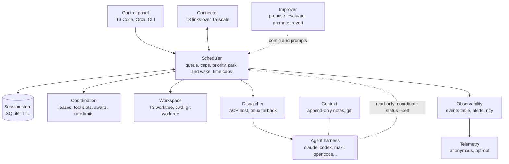
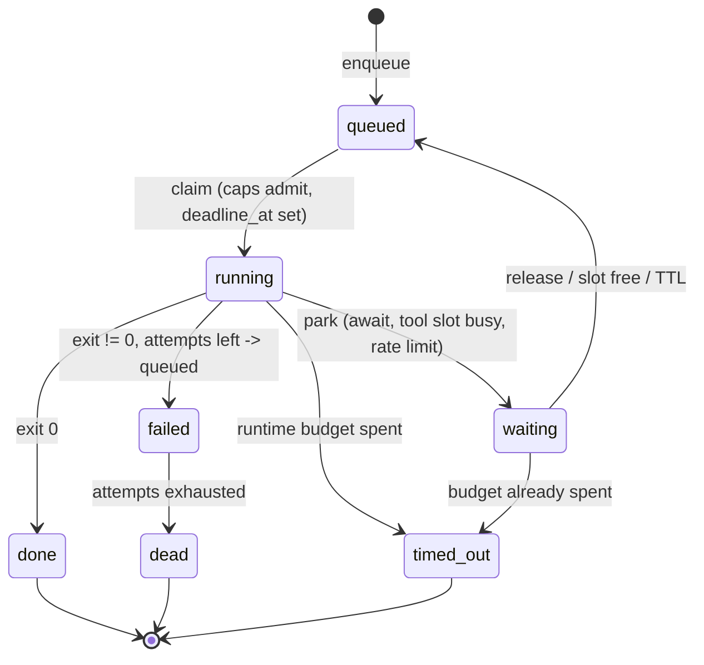

# Architecture

`coordinate` is a personal, local-first orchestration layer for AI coding-agent sessions. It runs on its own, and it is mostly used next to a control panel such as T3 Code or Orca. The name means to coordinate agents, and also a coordinate system: which device, which slot, which session. The CLI is `coordinate` and the per-device daemon is `coordinated`.

Rivet and Temporal are runtime frameworks that you build on. coordinate is a tool you run, aimed at agent orchestration. Its modules have plain interfaces so that parts can be swapped, and it could also ship as a library if that turns out to be useful.

Status as of 2026-11-23. The code is TypeScript compiled with scriptc. The binaries come from `ts/` through `scripts/build-bin.sh`. The Python version is on the `legacy/python` branch, and `main` has no Python, `pyproject.toml` or `uv`. These parts have not moved to TypeScript yet: ACP agent-session enqueue, the plugins runner, `coordinate service install` and `coordinate migrate`. In this document (M) marks a measured number and (D) marks a design that is not built. Anything unmarked is built and tested. Numbers measured before the port came from the Python version and say so.

Reference material is in `.agents/docs/`. Requirements and assessments are in `orchestrator-framing.md`, the scoring rubric in `tool-search-rubric.md`, candidate tools in `candidates-survey.md`. Spike reports are the `*-spike.md` files plus `bench-v2.md`, `bench-ci.md` and `timecap.md`. Designs are `readoption-design.md`, `toolcaps-design.md` and `fallback-design.md`, and research is under `research/`. The earlier `fleet` deployment architecture is `fleet-architecture-2026-11-20.md`.

## Requirements in one screen

- No external long-running process (no Postgres, Redis, Kafka). The whole stack stays under 200 to 300MB of memory, and storage is bounded by TTL.
- The store survives kill -9 and reboot.
- Agents keep working when the orchestrator stops: availability over consistency.
- Soft concurrency caps per device (for example 12 total split 3+5+5). Surplus is queued, parked or rate limited, never dropped.
- One orchestrator per device, local-first; one hub (kinosmac) hands out placement and cap allowances, and spokes keep running without it.
- Durable execution: a session resumes on the same or a different harness; waiting sessions are parked with no process.
- Awaits, locks, rate limits and time caps are tracked and visible.
- Single-responsibility modules behind interfaces, using maintained OSS where it beats our own code on the rubric.

## Modules

| Module | Responsibility | State | Interface |
|---|---|---|---|
| Scheduler | Queue, soft caps, global priority, park and wake, per-job time caps | built (SQLite), timecaps built | `enqueue`, `admit`, `park`, `wake`, `stats` |
| Session store | Durable job and session records, TTL and GC | built (SQLite, WAL) | `put`, `get`, `park`, `wake`, `expire` |
| Coordination | Machine, repo and tool slot leases, awaits, rate limits | built (leases, tool slots, `wait-on`/`release`) | `acquire`, `release`, `await`, `signal` |
| Dispatcher | Start, prompt, cancel, resume a session on a harness | shell jobs built; ACP via `fleet-acp` exists in the Python version on `legacy/python`, TypeScript port pending; tmux fallback (D) | `start`, `prompt`, `cancel`, `load`, `export_context` |
| Workspace | Give a job a working directory and release it | (D) T3 default, pass-through standalone | `prepare`, `release`, `describe` |
| Connector | Reach other devices, publish device state, delegate | T3 linked environments | `connect`, `publish_state`, `delegate`, `read_remote` |
| Observability | Events, alerts, `why`, notifications | (D) `research/observability.md` | `emit`, `query`, `alert` |
| Telemetry | Pseudonymous usage insights for the author, PostHog EU | (D) `research/telemetry.md` | `record`, `flush`, `status` |
| Context | Shared notes and handoffs across harnesses and devices | git, T3 threads; (D) beads-style append-only files | `append`, `read`, `handoff` |
| Improver | Tune config, prompts and plugins against the bench | (D) `research/self-improving-stack.md` | `propose`, `evaluate`, `promote`, `revert` |
| Control panel | Human view and control | T3 Code, Orca, the CLI | consumes the modules above |

Worktrees are not ours to enforce, because T3 and Orca already create them. Repo leases key on the repository and not on the worktree path. `project_key` resolves a worktree's `.git` file through its gitdir and commondir (or `git rev-parse --git-common-dir` with a 2s timeout), so every worktree of one repo shares the repo key.

## Files on disk

XDG locations on Linux and macOS alike (the convention CLI tools such as uv and gh follow on macOS too, rather than `~/Library`), resolved in one module and overridable by the `XDG_*` variables:

| What | Path |
|---|---|
| Config | `~/.config/coordinate/config.toml` |
| Queue, mailbox, events, telemetry outbox | `~/.local/state/coordinate/queue.db` |
| Logs | `~/.local/state/coordinate/logs/` |
| Runtime (pid files, locks, sockets) | `$XDG_RUNTIME_DIR/coordinate/`, else `~/.local/state/coordinate/run/` |

The queue is state, not data or cache. It matters across restarts, it is not a user document, and a TTL bounds its size. The Python version also read the legacy `~/.fleet/` files when the new ones were missing and copied them with `coordinate migrate`; the TypeScript port does not do this yet.

## Telemetry

Planned, not built. Nothing in the TypeScript code sends any data today. The design is on by default and pseudonymous, sent to PostHog EU (`https://eu.i.posthog.com`). The README will say so up front, a one-time notice appears on the first interactive run and at `coordinate service install`, and nothing is sent before that notice has been shown. `coordinate telemetry off` writes the config switch, and `DO_NOT_TRACK=1` is honored too. CI and tests never send. Only the daemon sends, from an outbox table: a daily summary and a few lifecycle and error events. It never sends prompts, outputs, paths, repo or branch names, hostnames, usernames, environment values, commands or error messages. Design: `.agents/docs/research/telemetry.md`. This must ship, with the README notice, before a release that includes it.

## Job lifecycle

The `jobs` row carries everything needed after a kill -9: `status`, `priority`, `run_at`, `lease_owner`, `lease_expires_at`, `waiting_on`, `attempts`, `max_attempts`, `max_runtime_s`, `runtime_used_s`, `deadline_at`, `claim_at`, `outcome`, `pgid`, `pidfile`, and the payload (including the durable ACP session id). `concurrency_slots` holds leases with a cost (machine, repo, `tool:<class>`). Parked time does not consume a job's runtime budget.

## Durability model

These results come from the Python version (`legacy/python`) and have not been re-measured on the TypeScript binary yet.

- Daemon kill -9 (M, `state-loss`): no job is lost and no lease leaks, parked jobs keep `waiting_on`, and the ACP session id survives. Every running job runs again, and a session that was mid-turn repeats one turn (at-least-once). The restarted daemon still enforces the time cap (M, 4.3s after the kill with a 3s cap).
- Daemon stop (SIGTERM): agents survive, but a restarted daemon cannot re-adopt them yet. (D) `readoption-design.md` turns the ACP client into a detached host with a journal and a lock file, and the daemon re-adopts before it reaps or claims. The target is zero duplicate turns when only the daemon died.
- Reboot: no process survives. Sessions resume through ACP `session/load` with one continuation turn.

## Agent contract

At spawn the daemon sets `COORDINATE_JOB_ID`, `COORDINATE_MACHINE` and `COORDINATE_DB`, and the old `FLEET_*` spellings as well. `COORDINATE_DEADLINE_AT` existed in the Python version and is not ported yet. An agent can read its own row with `coordinate status --self` and the queue with `coordinate stats`, and both are read-only. (D) The CLI should refuse commands that change the queue when the job id variable is set, unless the job has an explicit fan-out allowance.

## Measured footprint (VPS, Linux x86_64, 6 cores)

TypeScript binary against the Python version, same host, scriptc 0.4.16 (M, `.agents/docs/ts-port-spike.md`):

| Metric | Python | TypeScript |
|---|---|---|
| Enqueue through the CLI, median | 112.3ms | 4.9ms |
| Throughput, 60 trivial jobs at cap 6 | 7.7 jobs/s | 69 jobs/s |
| Daemon idle RSS | 57.4MB | 5.9MB |
| CLI startup | 128ms | 7ms |
| Binary size | n/a | 3.9MB (gnu), 4.9MB (musl) |

Parked sessions and wake time were measured on the Python daemon only (M): 10,000 parked sessions added under 1MB of RSS and took 250 to 350 bytes each in the table pages, and an event woke a parked session in p50 115ms and p99 167ms at 10,000 parked (`.agents/docs/park-wake.md`). The same alternatives on the same host: Restate 532MB idle, Rivet 128MB idle and 1,489MB at 10,000 parked actors, DBOS 82MB. Full table: `.agents/docs/orchestrator-framing.md`, assessment 9.

## Bench and CI

`.github/workflows/ci.yml` runs the TypeScript tests on every push and pull request. The Python bench harness (`bench/bench.py`, `bench/compare.py`) went away with the Python stack and is on `legacy/python`, so there is no regression gate on performance until the harness is ported or pointed at the TypeScript binary. `bench/results-*.json` and `benchmarks/legacy-python/thresholds.toml` stay as the cited historical measurements.

## Prototype plan

The inventory of what is still Python, with estimates, is in `.agents/docs/python-retirement.md`.

- P1, runnable and installable: mostly done. The package, CLI, `coordinated` and the `COORDINATE_*` variables (with `FLEET_*` as a fallback) exist in the TypeScript binary, the `project_key` worktree fix and the release workflow are in, and `install.sh` installs the binary. Pending in TypeScript: `coordinate service install|uninstall|status`, `coordinate migrate` and the XDG path module's config bounds.
- P2, visibility and wakeups: a `mailbox(job_id, kind, payload, dedupe_key, deliver_at)` table borrowed from the actor model (`research/actor-model.md`): each job has an addressable mailbox and undeliverable messages and exhausted jobs land in a dead letter mailbox; signals sent before a job parks are kept instead of lost (today `release()` only updates rows already waiting), wakes carry data, waits get a timeout and any-of, and alarms are messages with a future `deliver_at`. Then the events table, `coordinate events|tail|why|health|alerts`, ntfy alerts, telemetry with a first-run notice.
- P3, re-adoption: detached ACP host, single-instance daemon lock, safe kills by pidfd and start time, `orchestrator-kill` with 0 duplicate turns.
- P4, multi-device: hub allowances, presence levels, Workspace interface over T3.

Decisions are logged in `_own/.agents/decisions.md` (outside this repo) and summarized in `orchestrator-framing.md`.
