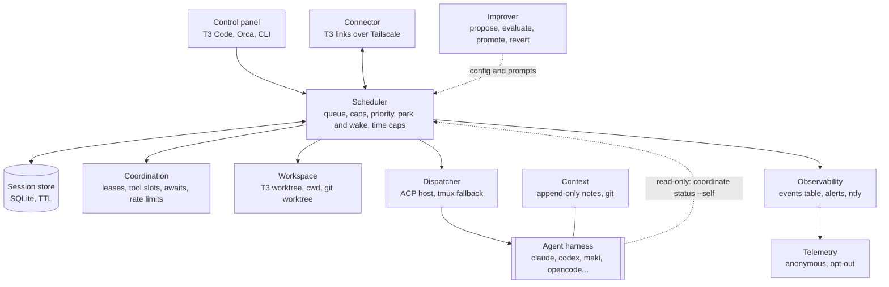
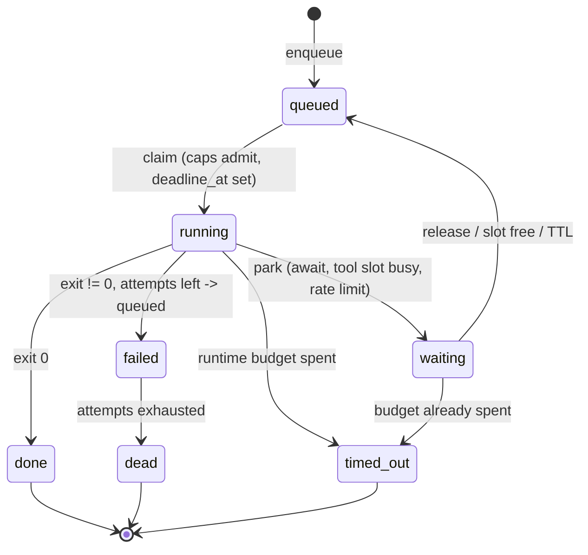

# Architecture

`coordinate` is a personal, local-first orchestration layer for AI coding-agent sessions. It runs standalone, but its main use is next to a control panel such as T3 Code or Orca. The name plays on two meanings: to coordinate (orchestrate) agents, and a coordinate system (which device, which slot, which session). The CLI is `coordinate`; the per-device daemon is `coordinated`.

Status as of 2026-11-23. Prototype slice P1 below is done: the package, CLI (`coordinate`, daemon `coordinated`) and env (`COORDINATE_*`, with `FLEET_*` read as a fallback) are renamed and state lives under XDG paths (`coordinate/paths.py`); legacy `~/.fleet` files are used with a notice until `coordinate migrate` copies them. Statements marked (M) are measured, (D) are designed but not built, everything else is built and tested.

Reference material lives in `.agents/docs/`: requirements and assessments in `orchestrator-framing.md`, the scoring rubric in `tool-search-rubric.md`, candidate tools in `candidates-survey.md`, spike reports (`*-spike.md`, `bench-v2.md`, `bench-ci.md`, `timecap.md`), designs (`readoption-design.md`, `toolcaps-design.md`, `fallback-design.md`) and research in `research/`. The previous deployment architecture of `fleet` is kept as `fleet-architecture-2026-11-20.md`.

## Requirements in one screen

- No external long-running process (no Postgres, Redis, Kafka). The whole stack stays under 200 to 300MB of memory, and storage is bounded by TTL.
- The store survives kill -9 and reboot.
- Agents keep working when the orchestrator stops: availability over consistency.
- Soft concurrency caps per device (for example 12 total split 3+5+5). Surplus is queued, parked or rate limited, never dropped.
- One orchestrator per device, local-first; one hub (kinosmac) hands out placement and cap allowances, and spokes keep running without it.
- Durable execution: a session resumes on the same or a different harness; waiting sessions are parked with no process.
- Awaits, locks, rate limits and time caps are tracked and visible.
- Single-responsibility modules behind interfaces, using maintained OSS where it beats our own code on the rubric.

## Modules

| Module | Responsibility | State | Interface |
|---|---|---|---|
| Scheduler | Queue, soft caps, global priority, park and wake, per-job time caps | built (SQLite), timecaps built | `enqueue`, `admit`, `park`, `wake`, `stats` |
| Session store | Durable job and session records, TTL and GC | built (SQLite, WAL) | `put`, `get`, `park`, `wake`, `expire` |
| Coordination | Machine, repo and tool slot leases, awaits, rate limits | built (leases, tool slots, `wait-on`/`release`) | `acquire`, `release`, `await`, `signal` |
| Dispatcher | Start, prompt, cancel, resume a session on a harness | built (ACP via `fleet-acp`, tmux fallback) | `start`, `prompt`, `cancel`, `load`, `export_context` |
| Workspace | Give a job a working directory and release it | (D) T3 default, pass-through standalone | `prepare`, `release`, `describe` |
| Connector | Reach other devices, publish device state, delegate | T3 linked environments | `connect`, `publish_state`, `delegate`, `read_remote` |
| Observability | Events, alerts, `why`, notifications | (D) `research/observability.md` | `emit`, `query`, `alert` |
| Telemetry | Anonymous usage insights for the author | (D) `research/telemetry.md` | `record`, `flush`, `status` |
| Context | Shared notes and handoffs across harnesses and devices | git, T3 threads; (D) beads-style append-only files | `append`, `read`, `handoff` |
| Improver | Tune config, prompts and plugins against the bench | (D) `research/self-improving-stack.md` | `propose`, `evaluate`, `promote`, `revert` |
| Control panel | Human view and control | T3 Code, Orca, the CLI | consumes the modules above |

Worktrees are not ours to enforce: T3 and Orca already create them. Repo leases key on the repository, not the worktree path `project_key` resolves a worktree's `.git` file through its gitdir and commondir (or `git rev-parse --git-common-dir`, 2s timeout), so worktrees of one repo share the repo key.

## Job lifecycle

The `jobs` row carries everything needed after a kill -9: `status`, `priority`, `run_at`, `lease_owner`, `lease_expires_at`, `waiting_on`, `attempts`, `max_attempts`, `max_runtime_s`, `runtime_used_s`, `deadline_at`, `claim_at`, `outcome`, `pgid`, `pidfile`, and the payload (including the durable ACP session id). `concurrency_slots` holds leases with a cost (machine, repo, `tool:<class>`). Parked time does not consume a job's runtime budget.

## Durability model

- Daemon kill -9 (M, `state-loss`): 0 jobs lost, 0 leases leaked, parked jobs keep `waiting_on`, the ACP session id survives; every running job runs again and a session that was mid-turn repeats 1 turn (at-least-once). The time cap is still enforced by the restarted daemon (M, 4.3s after the kill with a 3s cap).
- Daemon stop (SIGTERM): agents survive, but a restarted daemon cannot re-adopt them yet. (D) `readoption-design.md`: the ACP client becomes a detached host with a journal and a lock file, the daemon re-adopts before it reaps or claims, target 0 duplicate turns when only the daemon died.
- Reboot: no process survives; sessions resume through ACP `session/load` with one continuation turn.

## Agent contract

At spawn the daemon injects `COORDINATE_JOB_ID`, `COORDINATE_DEADLINE_AT`, `COORDINATE_MACHINE` and `COORDINATE_DB` (the old `FLEET_*` spellings are set too until P2). An agent can read its own row with `coordinate status --self` and the queue with `coordinate stats`. These are read-only; (D) the CLI refuses mutating commands when the job id env is set, unless the job has an explicit fan-out allowance.

## Measured footprint (VPS, Linux x86_64, 6 cores)

| Metric | Value |
|---|---|
| Daemon idle RSS | 18.5MB |
| 1,000 parked sessions | +0.2MB RSS, 0.3 to 4.4KB each on disk (two scenario variants, to reconcile) |
| Wake, event to agent running after `session/load` | p50 218ms, p99 392ms |
| Enqueue through the CLI, idle host | 97ms median (Python startup dominates) |
| Throughput, 60 trivial jobs | 9.7 jobs/s |
| Time cap precision | cap + grace + under 0.3s |

Alternatives measured on the same host: Restate 532MB idle, Rivet 128MB idle and 1,489MB at 10,000 parked actors, DBOS 82MB. Full table: `.agents/docs/orchestrator-framing.md`, assessment 9.

## Bench and CI

`bench/bench.py` runs scenarios against our backend or any adapter (`--cli "<shim>" --backend custom`). `bench/compare.py` gates a run against `bench/baseline-linux.json` using two bands: 2 x the stdev from `bench/noise-linux.json` and a per-metric percent in `bench/thresholds.toml`; a missing metric fails. `.github/workflows/bench.yml` runs the quick set on every PR once the repo is on GitHub.

## Prototype plan

- P1, runnable and installable (done): rename to `coordinate` (package, CLI, `coordinated`, `COORDINATE_*` env with `FLEET_*` fallback, XDG paths with legacy `~/.fleet` notice and `coordinate migrate`), drop the DBOS spike backend from the runtime, fix `project_key` for worktrees, `coordinate service install|uninstall|status` (systemd user unit, launchd agent), release workflow attaching the wheel and sdist to a GitHub Release, install with `uv tool install`.
- P2, visibility and wakeups: a `mailbox(job_id, kind, payload, dedupe_key, deliver_at)` table borrowed from the actor model (`research/actor-model.md`): signals sent before a job parks are kept instead of lost (today `release()` only updates rows already waiting), wakes carry data, waits get a timeout and any-of, and alarms are messages with a future `deliver_at`. Then the events table, `coordinate events|tail|why|health|alerts`, ntfy alerts, telemetry with a first-run notice.
- P3, re-adoption: detached ACP host, single-instance daemon lock, safe kills by pidfd and start time, `orchestrator-kill` with 0 duplicate turns.
- P4, multi-device: hub allowances, presence levels, Workspace interface over T3.

Decisions are logged in `_own/.agents/decisions.md` (outside this repo) and summarized in `orchestrator-framing.md`.
