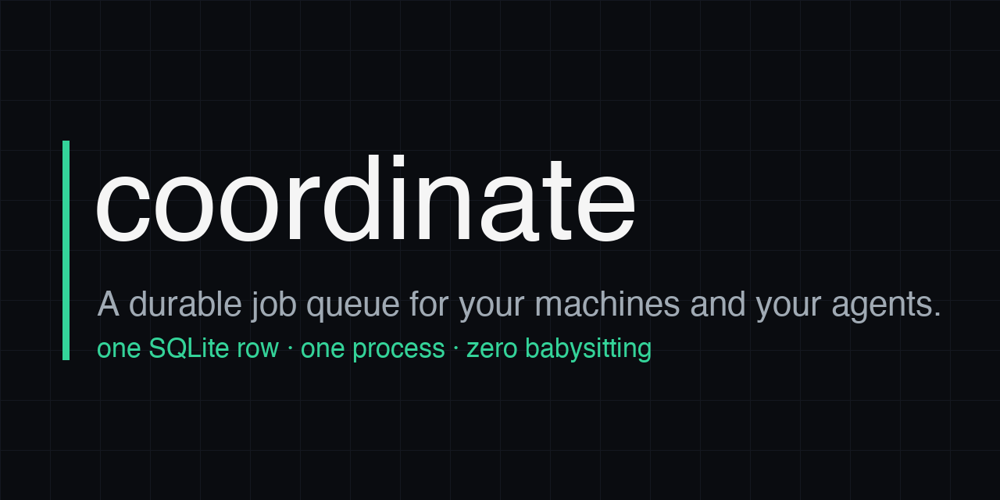

<p align="center"></p>

<h1 align="center">coordinate</h1>

<p align="center">A durable job queue for your machines and your coding agents.</p>

<p align="center">
  <a href="https://github.com/espetro/coordinate/releases"></a>
  <a href="https://github.com/espetro/coordinate/blob/main/LICENSE"></a>
</p>

```sh
curl -fsSL https://raw.githubusercontent.com/espetro/coordinate/main/install.sh | sh

coordinate daemon &
coordinate service install    # systemd user unit / launchd agent instead of a shell &
coordinate enqueue --shell -- 'pnpm test && pnpm build'
coordinate status
coordinate events --follow
```

macOS and Linux use `install.sh`; mise users can `mise use -g github:espetro/coordinate`. Windows (best-effort): `irm https://raw.githubusercontent.com/espetro/coordinate/main/install.ps1 | iex`.

`coordinate service install` sets up the daemon as a user-level service (systemd user unit on Linux, launchd agent on macOS; Windows is not supported yet), so it starts on login and survives PATH changes. `service status` and `service uninstall` manage it. See the [command reference](docs/cli.md).
## Why

- Enqueue in 5 ms and drain 69 jobs per second on a 6-core VPS.
- The daemon idles at 5.9 MB, and the whole tool is one 4 MB binary.
- 10,000 parked jobs take 3 MB of disk and no process.
- Jobs are SQLite rows. A crash or a reboot expires a lease, and the job runs again.
- Per-machine and per-repo caps, named slots, priorities, retries, deadlines and an event stream.

| Measured on the same 6-core VPS | coordinate | Rivet | Restate |
| --- | --- | --- | --- |
| Idle memory | 5.9 MB | 128 MB | 532 MB |
| 10,000 parked jobs | 3 MB on disk | 1,489 MB of memory | not run (851 MB at 1,000) |

Every number comes from a result file in [`benchmarks/`](benchmarks/).

## Docs

- [Architecture](ARCHITECTURE.md)
- [Benchmarks](benchmarks/)
- [Agent skill](skills/coordinate/SKILL.md): copy it into your agent's skills directory
- [Extension skill](skills/coordinate-extensions/SKILL.md): building on the event stream (`forward --exec`, `events --follow`)
- [Contributing](CONTRIBUTING.md)

## Make your agents use it

coordinate only bounds work that goes through the queue. To get agents to enqueue instead of spawning processes ad hoc:

1. **Give them the skill** — copy [`skills/coordinate/SKILL.md`](skills/coordinate/SKILL.md) into your agent's skills directory (e.g. `~/.agents/skills/coordinate/`). It teaches when to queue vs. stay interactive, plus every verb.
2. **Add one rule** to your agent's global instructions (e.g. `~/.claude/CLAUDE.md`, `AGENTS.md`):

   > All background/headless agent sessions and batch jobs on this machine MUST be enqueued as `coordinate` queue jobs (`coordinate enqueue`), never spawned ad hoc — queue caps are the device OOM control. Only interactive, user-watched work may run outside the queue.

3. **Hard enforcement** — for agent CLIs with hooks (Claude Code, devin), [`scripts/coordinate-guard`](scripts/coordinate-guard) is a PreToolUse hook that blocks spawning agent CLIs outside a queue job (jobs export `COORDINATE_JOB_ID`; the hook allows the spawn only when it is set). See `.agents/docs/enforcement.md` for the full spectrum from instruction-level to OS-level.

## Ecosystem

- [scriptc](https://github.com/vercel-labs/scriptc) — the TypeScript-to-binary compiler coordinate is built with
- [cutils](https://github.com/sigilco/cutils) — `@cutils/sqlite` and `@cutils/cli`, the scriptc-compilable packages under the hood
- [cauce](https://github.com/espetro/cauce) — sibling single-binary tool for agents

## License

[Apache-2.0](LICENSE). Copyright 2026 Joaquin Terrasa & contributors.
